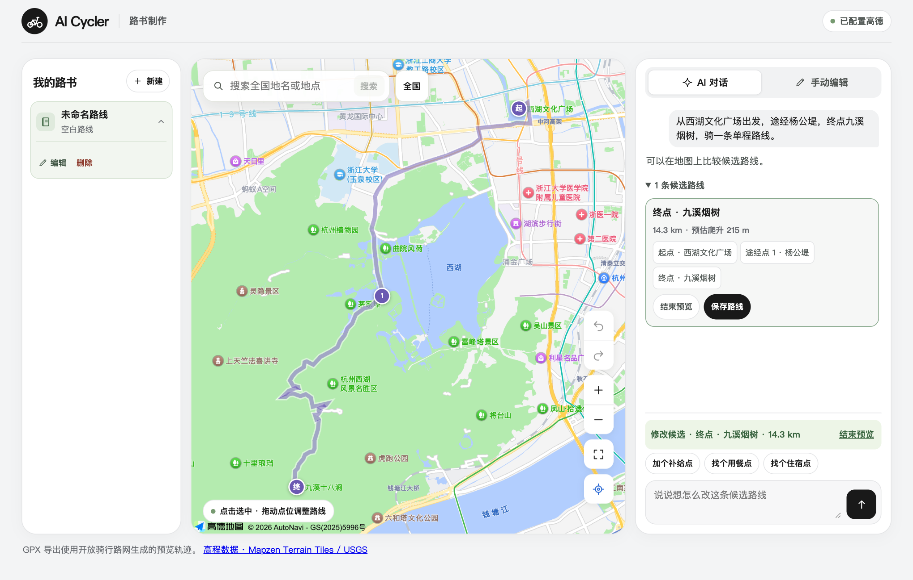
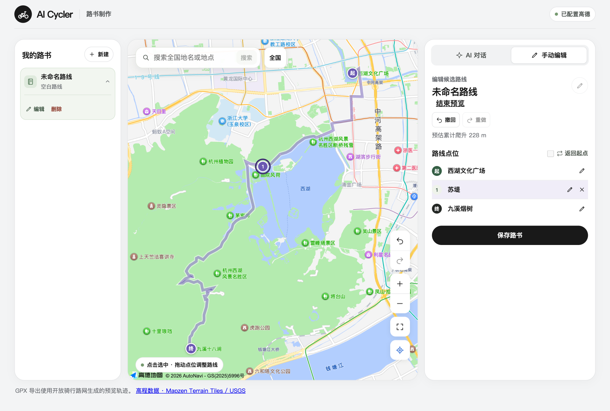
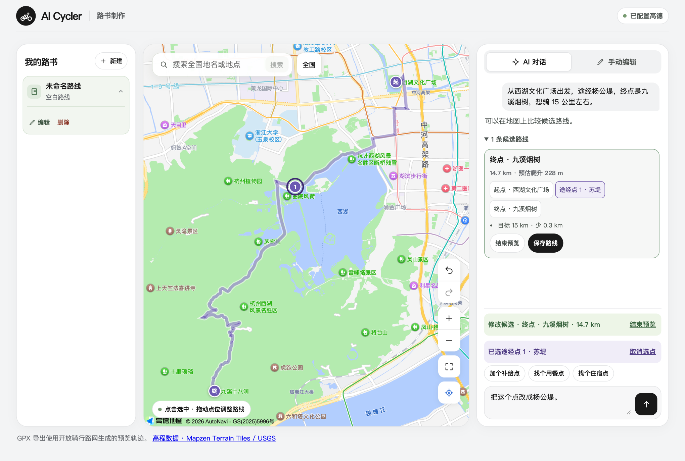
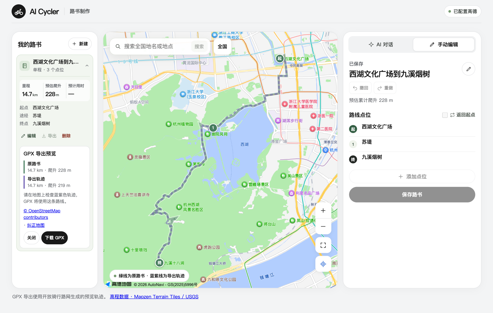

# AI Cycler · 路书制作

独立的骑行路线编辑器。可以在地图上创建和修改路线，也可以用自然语言生成候选。说「终点不限」时，助手会查找可骑达的单程终点。每份路书只保留一个已保存版本，可以从候选中替换。预览时，AI 对话和手动编辑以当前候选为目标。可以点选起点、终点或途经点后请 AI 调整并生成新候选。直接拖动、替换或删除点位会更新当前编辑版本，支持撤回、重做。确认保存后才更新路书。对话和编辑历史随当前页面保留。

## 快速开始

需要 Node.js 22 或以上版本。

```sh
git clone https://github.com/yininglee/cycler-roadbook.git
cd cycler-roadbook
npm ci
npm run dev
```

打开 [本地演示](http://127.0.0.1:4319)，使用杭州演示数据体验路线规划、地图编辑和 GPX 下载。演示模式无需 API Key。使用真实地图和模型时，请按[服务配置](#服务配置)填写自己的 Key。

端口占用时可用 `PORT=4320 npm run dev`。开发服务会在后端代码变动时自动重启。运行 `npm run check` 可执行语法检查和自动化测试。

## 核心功能

以下截图以配置高德地图后的杭州骑行路线为例。

### 用自然语言规划路线，再通过对话调整

在「AI 对话」里，可以先说个大概，比如「从西湖文化广场出发，想骑 15 公里左右，终点不限」。助手会查找可骑达的终点并生成候选路线。你可以在地图上预览候选，查看里程和预估爬升。

接着说「改成经过杨公堤，在九溪烟树结束」，助手会基于当前预览重新规划。你还可以继续调整里程、修改途经点或增加补给点，满意后再保存到「我的路书」。



### 选点修改，随时切换手动编辑和 AI 对话

**手动调整 AI 生成的候选。** 预览时可以直接拖动地图标记，也可以在「手动编辑」里搜索地点替换点位，或删除途经点。下图把杨公堤换成了苏堤，路线已重新计算，仍可撤回或重做。



**选中点位，接着用对话修改。** 切回「AI 对话」后，刚改好的苏堤仍在当前候选里。点击地图标记或候选卡片里的点位，再说「把这个点改成杨公堤」，助手就会在当前候选上调整选中的点。可以交替使用两种方式，满意后再保存到「我的路书」。



### 预览并下载 GPX

从「我的路书」生成导出预览。地图叠加绿色原路书和按 OpenStreetMap 骑行路网重新计算的蓝紫色虚线。对比两条轨迹的走向、里程和预估爬升后，点击「下载 GPX」即可保存预览中的轨迹。



## 使用说明

点击「新建」会在「我的路书」添加并选中一条空白路线。每条路线有自己的编辑内容和 AI 对话。再次点击选中的路线会关闭编辑区并扩展地图。路线列表和已保存的点位保存在当前浏览器。刷新时优先恢复服务端缓存的轨迹，缓存失效时按已保存点位重新算路。未保存的修改和对话在当前页面内随路线保留。

在已保存的路线里可以说「途中增加住宿的地方」「途中增加吃饭的地方」或者「途中加一个景点作为签到点」。助手按类别或关键词搜索路线附近的地点，保留已有点位并重新计算骑行路线。候选会显示新增点位和里程变化。

配置模型后，可以在一次对话里安排多段行程，例如「保留去程，到原终点后绕大学城一圈，找家餐厅，再经小洲便桥返程」。助手查找点位、逐段算路，并在需要时调整未通过核验的路段。候选会显示每段里程。

配置高德后，地图默认显示全国，可搜索各地地点并在高德有骑行路网的地区规划路线。点搜索框旁的「全国」回到总览，点地图右侧的准星并允许浏览器获取位置，地图会以蓝点标出当前位置。定位需要 HTTPS 或本机地址。

没有服务配置时进入演示模式。地图、道路、高程和补给数据都是固定的杭州演示数据，定位标记仅在演示地图范围内显示。下载的文件带「演示样例」标记，可用于验证 GPX 导入结构。实际外出骑行请使用经过核验的路书。

## 服务配置

可参考 `.env.example` 在项目根目录配置 `.env.local`，也可以使用 `.env`。本地启动会读取两者，同名变量以 `.env.local` 中的值为准。只在服务端使用 Web 服务 Key、JS API 安全密钥和模型 Key。修改配置后重启开发服务。

- **高德地图**设置 `AMAP_WEB_KEY`、`AMAP_JS_KEY` 和 `AMAP_JS_SECRET`。浏览器端加载 JS API，服务端请求地点搜索和骑行算路。 [高德 JS API 安全密钥文档](https://lbs.amap.com/api/javascript-api-v2/guide/abc/jscode) · [骑行路线规划](https://lbs.amap.com/api/webservice/guide/api/newroute)
- **LLM** 设置 `LLM_BASE_URL`、`LLM_API_KEY` 和 `LLM_MODEL`。地址指向支持 JSON 对象输出的 Chat Completions 兼容服务，例如供应商的 `/v1` 地址。模型根据草稿、上一轮条件和工具结果查找点位、试算路段、组合路线，也可以直接调用常见路线规划工具。选择开放终点时，路线工具沿多个方向查找落在目标距离附近的地点，并用骑行算路核验。未配置模型时，支持示例语句及常见调整。
- **高程**在 `.env.local` 设置 `ELEVATION_PROVIDER=terrain-tiles` 并重启，无需申请新 Key，也无需填写 `ELEVATION_URL`。后端按需读取公开的地形瓦片，在本地换算坐标、沿路线取样并估算累计爬升。瓦片服务只收到瓦片编号。地形估算在桥梁、隧道和高架附近可能偏离道路实际高度。 [Mapzen Terrain Tiles 数据说明](https://registry.opendata.aws/terrain-tiles/) · [数据来源与署名](https://github.com/tilezen/joerd/blob/master/docs/attribution.md)
- **自建高程服务**如已部署，可填写 `ELEVATION_URL`，其优先级高于内置数据源。后端向该地址 POST JSON，输入为 `{"coordinateSystem":"GCJ-02","coordinates":[[经度,纬度],...]}`，返回 `{"elevations":[海拔米数,...]}`，与输入严格同序。高程缺失或请求失败时标为「爬升暂无法核实」，带爬升硬上限的候选不可应用。

### 真实路线导出 GPX

在「我的路书」选中已保存的路线，点击「导出」和「生成预览」。服务仅使用确认的起点、途经点和终点坐标，在 OpenStreetMap 骑行路网上重新算路。地图以绿色显示原路书，以蓝紫虚线显示导出轨迹，并展示各自的里程与预估爬升。确认后下载预览所对应的 WGS84 GPX 1.1，文件包含路网署名。导出不修改已保存的路线。

本地个人使用默认接入 FOSSGIS 公共骑行算路服务，无需新 Key。服务会收到用于算路的点位坐标。若点位附近没有可接入的骑行路网，请调整该点后重试。如需使用自己的 OSRM 骑行实例，在 `.env.local` 写入 `GPX_OSRM_BIKE_URL`，其值为提供 `/route/v1/driving/` 的自行车配置实例根地址。 [FOSSGIS 使用及隐私说明](https://routing.openstreetmap.de/about.html) · [OpenStreetMap 路网署名](https://www.openstreetmap.org/copyright) · [GPX 1.1 规范](https://www.topografix.com/GPX/1/1/)

## 许可证

本项目的原创代码和文档采用 [MIT 许可证](LICENSE)。第三方依赖、截图中的地图内容、地图数据和外部服务适用各自的许可证或服务条款。
