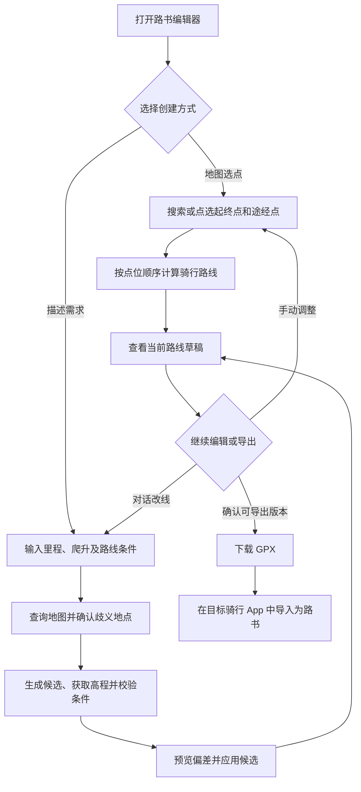
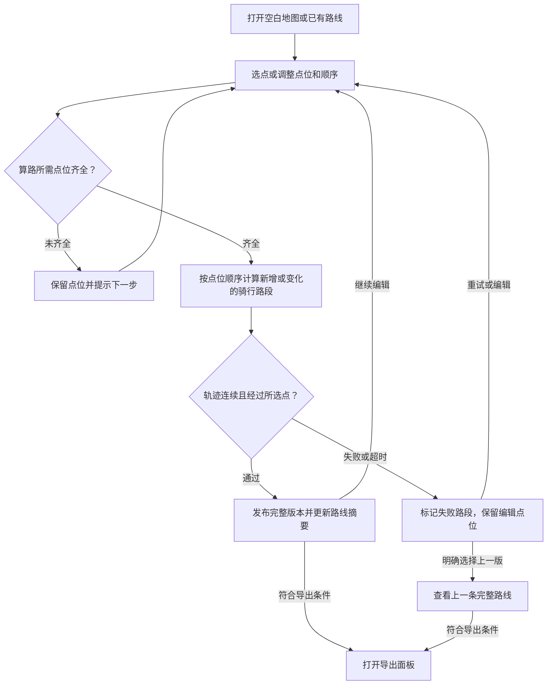
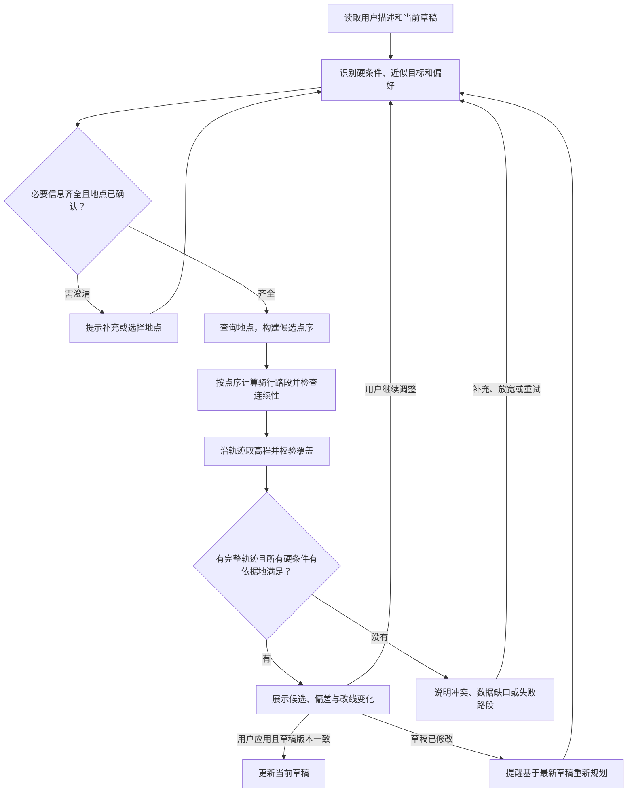
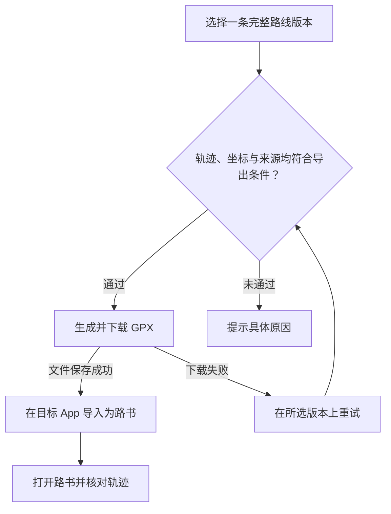

# 骑行路书制作 Agent · MVP PRD

| 字段 | 内容 |
| --- | --- |
| 版本 | v0.1 |
| 日期 | 2026-11-22 |
| 状态 | 草稿，按模块评审 |
| 产品形态 | 独立 Web 工具 |
| 需求依据 | [首版定型摘要](../shaping/06-shaped-brief.md) · [MVP 范围](../shaping/03-scope.md) · [页面与流程](../shaping/04-pages-and-flows.md) |

## 修改记录

| 日期 | 版本 | 变更 |
| --- | --- | --- |
| 2026-11-22 | v0.1 | 新增第 1 章「产品目标、范围与主流程」 |

## 1. 产品目标、范围与主流程

### 1.1 背景与目标用户

为全国骑友提供一个出发前制作个人路书的 Web 工具。用户可以直接在地图上点选起终点，也可以描述想骑的里程、能接受的累计爬升和想去的地点。无论从哪个入口开始，用户都能在地图上检查和修改同一份路线，完成后下载并导入自己常用的骑行 App。

| 场景 | 用户提供的信息 | 用户要完成的事 |
| --- | --- | --- |
| 已知道想怎么走 | 起终点，以及可选的途经点 | 在地图上创建路线，检查道路走向，调整某个点后下载。 |
| 已知道想怎么骑 | 例如「从西湖文化广场出发，骑 50 公里左右，累计爬升不超过 400 米，中途找个补给点，最后回到起点」 | 让 Agent 查地点、算骑行路线并估算爬升，核对候选路线满足了哪些条件，再应用或提出修改。 |
| 出发前导入 | 一条已经检查并应用的路线 | 在顽鹿运动、行者或 iGPSPORT 中把文件导入为路书，并确认导入轨迹与网页预览一致。 |

### 1.2 首版范围

| 能力 | 首版交付 |
| --- | --- |
| 手动创建与编辑 | 搜索地点或点击地图，设置起终点，添加、移动、删除和重排途经点。支持点到点和环线，沿骑行路网算路。 |
| Agent 规划与改线 | 读取里程、累计爬升、环线、必经点和补给条件，实际查询地图和高程信息，根据候选路线的计算结果校验条件。展示里程、预估累计爬升和条件满足情况，由用户应用候选。 |
| 路书预览 | 显示轨迹、起终点与途经点、距离、预估累计爬升及骑行时间。手动编辑和 Agent 改线作用于同一份草稿。 |
| 导出 | 从用户选定的完整路线下载文件，供个人手动导入。以 GPX 1.1 为拟采用格式，顽鹿运动、行者与 iGPSPORT 均须通过导入验收。 |
| 地区覆盖 | 面向全国骑友。按不同地区、地形和跨市路线抽样验证地点搜索、骑行算路和高程覆盖，记录有数据缺口的区域。 |

首版聚焦出发前的路线制作。实时导航、自动重路由、公开分享、多人协作、多日行程、第三方账号绑定及其他导出格式暂缓。

### 1.3 页面与区域职责

编辑器延续 AI Cycler 的浅灰背景、白色圆角卡片、黑色主按钮和蓝粉渐变的 AI 提示。小屏幕上，路线卡片可收起，方便继续查看和操作地图。

| 区域 | 主要信息 | 用户操作 |
| --- | --- | --- |
| 地图与地点搜索 | 点位、路线折线和搜索结果 | 搜索地点、点地图、移动点位、查看线路走向。 |
| 路线卡片 | 路线名称、距离、预估累计爬升、预计骑行时间和有序途经点 | 编辑途经点、打开对话或进入导出面板。 |
| 对话与候选预览 | 用户需求、待确认地点、候选路线、条件校验结果与偏差 | 描述路线、确认地点、预览和应用候选或继续改线。 |
| 导出面板 | 当前选定路线的摘要、下载操作及三端导入提示 | 下载对应版本的文件，失败时重试。 |

### 1.4 主流程

候选路线在用户应用后更新当前草稿。正在重算的草稿要等到轨迹完整才可导出。算路失败时，界面指出受影响的点或路段，并允许调整或重试。高程数据不足时，仍可查看已算出的路线和距离，累计爬升显示为待核实。

### 1.5 成功指标与验收口径

| 指标 | 记录口径 | 首版判断 |
| --- | --- | --- |
| 首次算路成功率 | 首次提交时已具备必要地点信息的任务中，首次算路得到连续、可预览路线的比例。手动和 Agent 分别统计。 | [待确认: 多地区测试样本和目标值] |
| 首次导出耗时 | 在端到端测试中，从打开编辑器到第一份文件保存成功的时间，包含用户确认与编辑。分别记录手动和 Agent 路径。 | [待确认: 基线与目标值] |
| 规划条件校验 | 对必经点、环线、里程、累计爬升、补给逐项核对候选路线及其标注。分别覆盖数值上限、近似目标和数据不足。 | 硬条件未满足或无法核实时，不能标为已满足。距离近似区间和爬升误差以实测确定。 |
| 三端导入通过 | 用同一份生成文件，在顽鹿运动、行者、iGPSPORT 分别检查路书导入、轨迹连续性及地图对齐。 | 三款 App 分别通过。测试样本、版本和代表设备在导出模块记录。 |

## 2. 地图手动创建与编辑

### 2.1 目标与用户故事

| 场景 | 用户任务 | 完成标准 |
| --- | --- | --- |
| 从空白地图开始 | 选定起终点，按需要加入途经点 | 地图绘出按点位顺序连接的骑行路线，路线卡片显示对应的距离和预估数据。 |
| 制作环线 | 选定出发点与至少一个可区分的途经点，选择「返回起点」 | 路线按顺序经过途经点并回到出发位置。 |
| 修改已有路书 | 在自己画的路线或已应用的 Agent 路线上移动、增删或重排途经点 | 路段、卡片指标和可导出的版本同步更新。改线失败时可继续修改或查看上一条完整路线。 |

### 2.2 主流程

### 2.3 交互与编辑规则

| 操作 | 交互 | 算路与校验 |
| --- | --- | --- |
| 设置起终点 | 从地图或搜索结果选择地点，并指定为起点或终点。搜索结果展示名称和地区或地址。存在同名结果时，由用户选择具体地点。 | 点到点需要两个可区分的端点。信息不足时保留已选点，提示补充所缺点位。 |
| 创建环线 | 用户选择「返回起点」，并添加至少一个位于起点之外的途经点。移动起点后，终点随之更新。 | 按「起点 → 途经点 → 起点」算路。校验首尾闭合。缺少有效途经点时提示补充。 |
| 添加途经点 | 从地图或搜索选择点位，并选择插入的位置。地图标记与列表编号随顺序同步。 | 在原有相邻点之间插入新点，计算两条新路段。 |
| 移动点位 | 可以在地图上调整标记，也可以从列表选中点位后重新选点。用户确认新位置后提交编辑。浏览、拖动底图和缩放地图不触发编辑。 | 重算与该点相连的路段。移动环线起点时重算出发和返回两个方向的相关路段。 |
| 删除或重排途经点 | 列表提供删除和调序操作。点位被移除后，地图标记和列表同步更新。 | 删除时连接剩余的相邻点。重排时按新的有向点对重新算路，保留方向和两端坐标均相同且可复用的路段。 |
| 查看当前版本 | 卡片显示路线、距离、预估累计爬升和预计骑行时间。重算期间标明正在更新。 | 路段全部通过校验后更新轨迹、点位和距离。高程随后补齐时只更新同一版本，缺失时显示「爬升暂无法核实」。估时缺失时显示「暂无预计时间」。 |

- 路段应使用骑行算路结果，按点位顺序拼接。拼接前检查每段端点与确认点位、相邻两段接缝以及环线首尾。若吸附偏移超过允许范围或无法拼接，在地图和列表中提示调整具体点位。[待确认: 端点吸附、路段接缝和环线闭合容差，由实测确定]
- 路线总距离使用当前完整版本的路段距离，累计爬升使用对应轨迹的高程估算。点位发生变更时，旧版本的爬升和估时不得作为新路线的数据展示。
- 手动编辑经确认并算路成功后，完整结果直接成为当前草稿。Agent 生成的候选仍需用户选择「应用」后进入同一草稿。
- 每次提交点位或顺序变更时更新草稿修订标识。搜索、算路、高程和重试结果仅更新与当前操作匹配的数据。用户连续两次改点时，较早返回的轨迹和指标都不能覆盖后一次编辑。
- 在已应用的 Agent 路线上手动编辑时，先更新草稿，再按新路线重新核对可计算的条件。旧候选的条件结论只对应原版本。

### 2.4 状态与失败恢复

| 状态 | 界面表现 | 导出行为 |
| --- | --- | --- |
| 缺少点位 | 保留已选点和顺序，提示「选择终点」或「添加环线途经点」等下一步操作。 | 当前编辑结果不可导出。 |
| 正在重算 | 显示本次编辑后的点位和「正在重算」。如果同时保留旧轨迹供参考，应标明「上一版」。 | 等待当前轨迹通过校验。 |
| 无骑行路线、断段或超时 | 指出受影响的路段；保留当前待编辑点位，允许改点或重试。若已有完整版本，提供「查看上一版」。 | 失败的版本不可导出。用户明确选中上一版后，导出面板才可绑定该版本。 |
| 轨迹完整、高程不足 | 地图和距离可查看，卡片显示「爬升暂无法核实」。 | 按完整轨迹与导出资格判断。 |
| 完整版本可用 | 地图、点位列表和路线摘要指向同一版本。 | 符合来源授权和坐标要求时，可从该版本下载 GPX。 |

### 2.5 验收标准

| 用例 | 给定条件与操作 | 通过标准 |
| --- | --- | --- |
| MAN-01 点到点 | 从空白地图点击起点，再搜索并选择终点。 | 选点前按缺失项提示。两个端点齐全后，路线沿算路结果显示，端点与选择一致，距离对应当前轨迹。 |
| MAN-02 同名地点 | 搜到两个同名地点，选择其中一项。 | 列表提供可区分的地址或地区，选定前草稿点位不变，选定后使用所选地点计算。 |
| MAN-03 手动环线 | 选择「返回起点」，先查看仅有起点的状态，再添加一个途经点。 | 提示补充途经点；添加后路线经过该点并回到起点，闭合结果符合容差。 |
| MAN-04 移动、插入、删除和重排 | 准备起点 A、途经点 B/C、终点 D。独立执行移动 B、在 B/C 之间插入 E、删除 B、交换 B/C。 | 移动 B 更新 A→B 和 B→C；插入 E 以 B→E 和 E→C 代替 B→C；删除 B 新增 A→C；对调后按 A→C、C→B、B→D 计算。每次变更后均检查轨迹、点序及里程。 |
| MAN-05 失败与重试 | 有一条完整路线，将一个途经点移到无可用骑行路段的位置，或模拟分段超时。 | 地图指出失败段并保留新点位；当前编辑结果不可导出。改点或重试成功后可继续使用新版本。单独选择上一版时，导出文件绑定上一版。 |
| MAN-06 断段 | 使两段算路结果分别成功，但共同途经点附近的接缝超出容差。 | 路线被标为未完成，界面指出需处理的位置，导出入口不提供该版本。 |
| MAN-07 连续编辑 | 迅速将同一个点改到位置 X 和位置 Y，使 X 的请求最后返回。 | 地图和列表显示 Y，卡片和导出仅引用 Y 对应的完整版本；X 的晚到结果和指标均被忽略。 |
| MAN-08 高程缺失 | 改线后的新轨迹完整，模拟高程取样不足。 | 地图和距离更新，爬升显示待核实。界面无旧版本的爬升值，也无代填的零爬升。 |
| MAN-09 编辑 Agent 路线 | 应用一个 Agent 候选，再在地图移动途经点。 | 地图与对话继续引用同一草稿。新路线的指标和条件结论按当前版本更新。 |

## 3. Agent 规划与对话改线

### 3.1 入口与任务

用户可从空白编辑器描述路线，也可在已有草稿中说「保留起终点和必经点，把累计爬升降到 300 米以内」。Agent 根据文本和当前草稿收集必要信息，查询地点、骑行轨迹和高程，并展示有依据的候选。用户选择「应用」后，候选才成为当前草稿。

| 用户表述 | 规划规则 | 结果展示 |
| --- | --- | --- |
| 「从西湖文化广场出发」「到湘湖」「必经六和塔」 | 使用用户点选或地点服务已确认的位置。按用户明确指定的顺序途经。地名存在多个可能地点时，显示候选地点及地址，请用户确认。 | 地图标出对应起终点和必经点，显示实际途经顺序。 |
| 「骑 50 公里左右」 | 把 50 公里视为近似目标。用候选的实际里程计算偏差，并用于排序。超出近似范围属于偏差。 | 例如「52.6 公里，比目标多 2.6 公里」。[待确认: 默认近似范围] |
| 「最多 50 公里」「40 到 50 公里」 | 把明确区间和上限作为硬条件，使用未按界面精度四舍五入的距离比较，区间和「以内」包含边界。 | 显示实际里程和偏差。接近边界时保留足以区分超限的显示精度。 |
| 「尽量少爬升」「累计爬升不超过 400 米」 | 前者用于有可比较高程的候选排序；后者使用通过覆盖校验的预估累计爬升比较，采用未按界面精度四舍五入的值，400 米满足上限。 | 标为「预估累计爬升」。数据不足时显示「待核实」，不用于判断上限已满足。 |
| 「骑一圈回到起点」 | 终点绑定到起点。当用户只给起点和目标里程时，搜索合适的候选途经点并尝试少量不同走向，检查路线闭合。能避开重复路段时优先考虑。 | 显示起终点、途经点及实际里程。若只能找到原路折返的方案，明确标为折返，不把它标作环线。 |
| 「中途找个补给点」「必须经过某家便利店」 | 用地点搜索找可到达的补给点。指定具体门店或强制要求补给时，候选必须经过符合条件且能沿骑行路网接入的点。若用户给出补给距离范围，按从起点骑行的累计距离判断。 | 显示名称、位置、预计骑到的里程。存在相同已确认点位的无补给参考路线时，按两条路线的里程差说明绕行。营业和库存以可核实信息为依据。 |

### 3.2 规划与应用流程

### 3.3 校验与排序

1. **确认需要澄清的条件。** 缺少无法从当前草稿确定的起点时询问起点。点到点任务需要终点，环线可复用起点。地名歧义和相互冲突的硬条件由用户澄清。仅有「少爬升」等可直接用于排序的偏好时，可以继续生成。
2. **基于工具结果算路。** 地点、坐标和骑行轨迹以地图服务结果为依据。相邻途经点分段算路，沿用第 2 章的连续性、经过点位和闭合检查。检测地点服务无结果、算路超时、无可骑路段和拼接失败，界面给出对应地点或路段。仅对完整轨迹展示全程里程。
3. **估算累计爬升。** 对完整轨迹使用与高程服务坐标系一致的采样点，按固定采样、缺失处理和平滑口径累计正向高程变化。缺失范围超出可接受门槛时，保留轨迹和里程并显示「爬升暂无法核实」。同一轨迹和高程样本应得到一致结果，峰谷以及桥梁、隧道路段纳入校验。[待确认: 高程来源、采样和平滑参数、最低覆盖和误差口径]
4. **先检查硬条件，再比较偏差和偏好。** 逐项标注「满足」「未满足」或「待核实」，用用户明确的优先级比较偏好。只有满足所有硬条件的完整候选可从 Agent 预览应用。全部候选均不符合时，可展示接近方案和具体差值供参考。用户明确放宽相关条件后再校验。若条件待核实，提供重试或修改条件的入口。近似目标有偏差但硬条件满足时，用户看到偏差后仍可应用。
5. **基于当前草稿改线。** 对话改线继承当前路线和此前已确认、未被修改的条件。预览列出点位、距离和预估爬升的变化。候选绑到请求时的草稿版本与条件，期间发生更新时，旧候选不能应用到新版本。查询、算路或高程失败时，现有草稿仍可查看和编辑。

### 3.4 验收标准

| 用例 | 给定条件与操作 | 通过标准 |
| --- | --- | --- |
| AGT-01 地点澄清 | 从空白草稿输入「骑 50 公里环线」，随后输入一个有同名结果的起点。 | 先询问起点，再显示可区分的地点供选择。选定前没有新路线写入草稿。 |
| AGT-02 里程边界 | 分别用 49.9、50、50.04、52.6 公里的候选验证「最多 50 公里」与「50 公里左右」。 | 硬上限下 49.9 和 50 公里通过，50.04 与 52.6 公里判为超出。近似目标展示实算里程与偏差，允许满足其他硬条件的候选供用户选择。 |
| AGT-03 爬升边界与排序 | 候选有 350、400、400.4 米的有效估算值，分别输入「最多 400 米」和「尽量少爬升」。 | 上限模式下 350、400 米通过，400.4 米判为超出。仅将累计爬升作为偏好时，其他条件相同下优先 350 米。 |
| AGT-04 高程缺失 | 轨迹连续但高程覆盖低于验证门槛，分别对无爬升硬条件和有爬升硬上限的任务测试。 | 两种情况均显示地图和里程，爬升明确待核实。无爬升硬条件且其余硬条件满足时可应用；有爬升硬上限时须核实或修改条件后才能应用。 |
| AGT-05 环线与必经点 | 要求回到起点，按顺序经过 B、C。准备闭合方案、漏点方案和原路折返方案。 | 推荐符合顺序并闭合的候选。漏点标为未满足。原路折返须明确说明，并在用户改为接受折返后才可应用。 |
| AGT-06 补给 | 指定第 20 至 30 公里补给。候选门店分别位于该区间内外，并准备一个必须到访的同名门店。 | 用沿实际路线的累计里程检查补给时机；指定门店需要确定位置并在轨迹上经过。缺少营业数据时不显示营业承诺。 |
| AGT-07 无解或服务失败 | 组合相互冲突的硬条件；另模拟地点搜索超时或不存在骑行路段。 | 分别说明冲突和服务失败，提供修改条件、选点或重试入口。原草稿保留。无符合候选时不得应用接近方案。 |
| AGT-08 对话改线与版本 | 基于已有草稿要求降低爬升；预览后先手动移动途经点，再尝试应用旧候选。 | 首次预览展示变化并保留未修改的约束。手动编辑成功后旧候选不能覆盖新草稿，用户可基于新版本重试。 |

## 4. GPX 导出与三端导入验收

### 4.1 用户流程

用户从路线卡片打开导出面板，核对名称、路线版本、距离和预估累计爬升，点击「下载 GPX」。打开面板时绑定用户所选的完整版本。若底层路线已更改，明确显示面板所对应的版本，用户可返回查看当前路线后重新打开。下载失败时保留路线与版本选择，允许重试。下载结束后，用户在自己的骑行 App 里将文件作为路书导入。

### 4.2 文件规则

| 项目 | 要求 |
| --- | --- |
| 导出资格 | 用户已选择的完整版本，且轨迹来源明确允许此用途、坐标可正确输出。待算路、断段、Agent 尚未应用的候选，以及来源许可或坐标未验证的轨迹不可导出。 |
| 格式 | 扩展名为 `.gpx`，文件使用 UTF-8，通过 GPX 1.1 XML Schema 校验。中文路线名可识别，XML 特殊字符正确转义。 [GPX 1.1 规范](https://www.topografix.com/GPX/1/1/) |
| 轨迹结构 | 首版基线采用一条连续的 `trk` 轨迹及一条 `trkseg`，按骑行顺序写入 `trkpt`，所有经纬度采用 WGS84。导出后检查起终点、关键途经位置、道路走向和环线首尾，并检查接缝是否引入跨路网的直线。 [GPX 1.1 规范](https://www.topografix.com/GPX/1/1/) |
| 高程与时间 | 路线卡片显示预估爬升。可验证的高程可选写入 `ele`，缺失时省略该字段。拟规划路书无需写入骑行记录时间。三端高程保留和显示行为单独记录。 |
| 来源与版本 | 生成文件必须与所选版本一致。导出时复制该版本的轨迹、点序和名称。跟随编辑更新的界面不能改变已发起下载所对应的文件内容。 |

### 4.3 三端验收矩阵

对每条样本，从本工具下载一次，三端使用**同一份原始文件**。留存文件摘要、对应网页版本、系统与 App 版本、导入入口、导入结果、地图截图与设备型号。参考资料只用于找到导入路径，产品兼容性以本工具生成的文件实测为准。

| 目标 App | 导入验证路径 | 该端通过条件 | 当前结果 |
| --- | --- | --- | --- |
| 顽鹿运动 | 进入路书或我的路线，使用 GPX 导入入口打开测试文件。记录所测版本的实际菜单。 [顽鹿运动应用说明](https://app.mi.com/details?id=com.onelap.bls.dear) | 保存为个人路书并能重新打开；地图轨迹通过下方通用检查。 | 待实测 |
| 行者 | 在「路书」页面选择「导入路书」，选择 GPX 文件后打开生成的路书。 [行者帮助中心](https://hc.imxingzhe.com/hc/xing/articles/1702004975-) | 导入为路书并能预览或用于路书导航；地图轨迹通过下方通用检查。 | 待实测 |
| iGPSPORT | 在 App 中导入 GPX 为导航线路，并在 App 内打开。使用支持路书的代表设备时，验证从 App 发送并在设备端打开。 [iGS630S 使用说明](https://igp-zh.oss-cn-hangzhou.aliyuncs.com/pdf/2024/6/7b380ada5c8ea18a39105ab26d12fff3.pdf) | App 内可见导航线路且地图轨迹通过下方通用检查；设备复验记录同步及打开结果。 | 待实测 |

**通用通过条件**

1. 直接导入原始文件为可再次打开的路书或导航线路，无需改名、转格式或手动修补。中文路线名可识别，记录目标端是否追加或裁切名称。
2. 检查路线起点、终点、关键途经道路和地图地标。路线位置应与网页预览及已知地标一致，在约定容差内，无整体平移、明显走错并行道路或方向反转。
3. 沿路线核对转向、分段接缝和远端路段，轨迹不截断、不跳线；环线保持闭合。目标 App 的里程若自行重算，记录与网页里程的差值。超出允许偏差时检查是否丢点、截断或改变轨迹。
4. 对支持路书同步的代表码表，从对应 App 发送后可在设备端打开同一路线。设备测试记录型号、固件、同步结果及轨迹复核结果。初次实测确定首发支持的系统版本和代表型号。[待确认: 三端系统与设备组合、位置和里程容差]

### 4.4 验收用例

| 用例 | 准备与操作 | 通过标准 |
| --- | --- | --- |
| GPX-01 中文点到点 | 创建一条含中文和 XML 特殊字符名称的点到点路线，下载一次，分别导入三端。 | 文件通过 Schema 校验；三端的路书名可识别，起终点和路线方向正确。 |
| GPX-02 多点环线 | 下载一条带必经点和补给点的连续环线。 | 三端轨迹依次经过对应道路位置、首尾闭合，接缝无跳线。补给名称或独立图标的显示以目标端行为记录，核验以经过位置为准。 |
| GPX-03 长路线和编辑版本 | 选取较长、点数较多的跨市样本，改动一个途经点后，从选定版本下载。 | 下载内容与该版本一致，三端检查全程未截断、远端路段仍完整显示。若遇到端侧长度、点数或体积限制，记录实际限制与影响版本，确认首发支持边界。 |
| GPX-04 高程可用与缺失 | 分别使用带有效高程和无高程字段的样本。 | 两种文件均可作为路书导入，轨迹完整。目标端爬升和海拔显示差异有记录。 |
| GPX-05 导出失败与重试 | 依次模拟文件生成失败、尚未完成的轨迹和缺少授权或有效坐标的轨迹。 | 生成失败可在同一版本重试；不具备导出资格时提示具体原因，下载不产生错误路线文件。 |

三端分别记为通过、失败或待验证。每个目标 App 都要在确认的首发测试组合下通过适用用例。下载成功、单端导入成功及厂商资料中的格式支持均不能替代另外两端的实测。

## 5. 数据、异常与发布前待决事项

### 5.1 数据与更新规则

| 数据 | 关键内容和来源 | 更新时机 |
| --- | --- | --- |
| 规划需求 | 用户原话、已确认地点与顺序、里程和爬升约束、环线需求、补给偏好 | 用户提交新需求、确认地点或修改条件时；用于追溯候选的约束。 |
| 草稿及版本 | 有序点位、手动或 Agent 来源、当前编辑修订标识、最近完整版本与用户选定的导出版本 | 手动提交编辑时记录修订；完整算路通过或用户应用合格候选后更新完整版本。候选预览保留其依赖的草稿版本。 |
| 骑行轨迹 | 分段起终点、轨迹点、距离和预计时间、坐标系、地图或算路服务来源 | 算路通过后关联对应版本。若只完成部分路段，记录当前失败或等待状态。 |
| 高程与爬升 | 高程数据来源、采样覆盖、计算口径与估算值 | 高程结果返回后仅更新匹配的轨迹版本；覆盖不足记录为待核实。 |
| 导出与验收 | 轨迹版本、WGS84 文件、导出结果、测试文件摘要与三端验收证据 | 下载绑定用户选定的完整版本；导入行为由实测记录。 |

草稿用于个人使用，建议默认私有。登录方式、是否跨会话保存、存储位置与保留期限待确定。地图服务接收完成搜索和算路所需的地点与坐标。建议指标采集使用任务结果、耗时、入口、失败类别和受影响的服务，地点文本和精确轨迹仅在专项验收授权范围内留存。

### 5.2 共用异常与观测

- **地点、高程或算路服务不可用。** 提示失败的步骤，并允许在当前流程重试。地图和高程分别反映可用状态，完整轨迹可继续预览，服务失败的结果不替换已有完整版本。
- **草稿版本改变。** 检查异步结果、Agent 候选和导出操作的目标版本。过期结果无法更新当前轨迹，用户可按提示重新生成或明确选取上一版。
- **指标采集。** 建议从首次提交、首次完整路线就绪、导出生成成功与失败等节点记录时间和结果。浏览器端文件是否实际保存以及第三方导入是否成功，以端到端验收为准，统计口径与第 1 章一致。

### 5.3 发布前验证

| 事项 | 验证证据 | 当前状态 |
| --- | --- | --- |
| 地图、算路及轨迹用途 | 优先验证高德底图、地点搜索和骑行算路。确认轨迹保存、下载和第三方设备使用权限。验证产出 WGS84 轨迹的可用路径和与底图的对齐。若高德轨迹无法满足，验证允许导出的替代轨迹来源。 [高德开放平台协议](https://lbs.amap.com/pages/terms) · [高德坐标说明](https://lbs.amap.com/faq/basis/location/1060046657) | 待验证 |
| 高程估算 | 用平路、山路、桥隧样本对比参考数据，记录缺失率、重复计算一致性和累计爬升误差。定下采样口径、覆盖阈值与误差容差。 [Copernicus 高程数据说明](https://dataspace.copernicus.eu/explore-data/data-collections/copernicus-contributing-missions/collections-description/COP-DEM) | 数据源和验收阈值待确认 |
| 全国覆盖 | 使用城市、郊县、山地、跨市及港澳台样本验证地点、路网、高程与补给覆盖。记录失败区域、路线类型、路段服务和用户可见的提示。 | 待实测 |
| 三端文件兼容性 | 保存四类路线样本和明细结果，包括点到点、多点环线、长路线及高程缺失。三家分别记录通过情况、机型和版本，识别发布范围。 | 三端待实测 |
| 发布范围与指标阈值 | 根据覆盖与导入实测确定首发支持组合、限制说明、量化指标目标和草稿保存方案。 | 待确认 |

## 附：自检与待完善清单

- [x] 地图创建、手动编辑、Agent 生成与应用、GPX 导出使用同一条草稿及版本规则。
- [x] 手动编辑和 Agent 的主流程、状态、异常及可执行验收用例已列出。
- [x] 里程、累计爬升、环线、必经点和补给可分别验收。明确上限、近似目标与偏好按不同规则判断。
- [x] 顽鹿运动、行者、iGPSPORT 各有导入路径、通过条件和结果记录要求。
- [ ] 确认实际轨迹数据源、使用授权、坐标方案、全国覆盖及三端实测结果。
- [ ] 根据实测确定地点吸附、接缝与闭合容差、近似里程区间、爬升误差、各端支持范围与量化目标。
